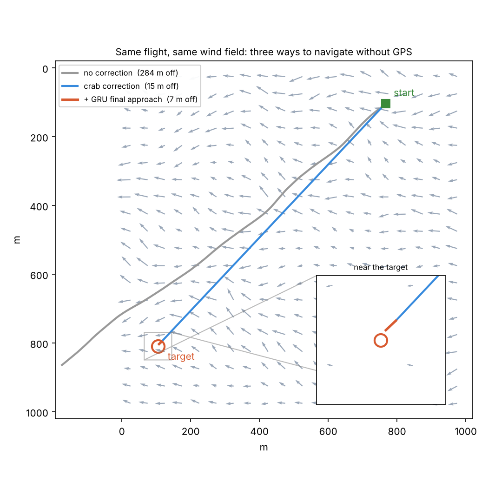

# DeadReckoning

A drone simulator for navigating without GPS. The drone has a compass, an anemometer and a clock, and has to reach a target through a wind field that changes from place to place. Classical wind-triangle corrections get it most of the way. A small recurrent network then reads the flight's sensor log and corrects the remaining miss.



## The problem

Without GPS, a drone only knows where it *should* be: it points at the target and flies for the time the distance requires. Wind pushes it sideways and slows it down, and every second of drift adds to the landing error. The drone never sees its true position. It has to infer what the wind did from what its own sensors felt.

In this simulator, the drone knows its start, its target and its own airspeed. In flight it reads only:

- **compass**: its heading
- **anemometer**: apparent wind speed and angle, relative to the drone
- **clock**: elapsed time

The true position exists only inside the physics engine. The controller never reads it. Training reads it once per flight, to build the label.

## Three levels of navigation

1. **No correction.** Turn toward the target, fly for distance ÷ airspeed seconds, stop. The wind decides where it lands.
2. **Crab correction.** At every step the drone recovers the true wind from the apparent wind and its own velocity. It solves the wind triangle for the crab angle that keeps it on track, within a maximum turn rate, and extends its flight time to make up for headwind.
3. **GRU final approach.** After the planned flight ends, a GRU reads the full sensor log (apparent wind angle, apparent wind speed and heading at every step). It predicts one heading change and the extra flight time needed to reach the target.

## Results

These are 100 flights with random wind fields and random start and target points. The average flight is about 400 m, and the GRU uses the pretrained weights.

| Navigation | Mean miss | Median miss | Landed within 25 m |
|---|---|---|---|
| No correction | 140 m | 130 m | 7 / 100 |
| Crab correction | 17 m | 9 m | 74 / 100 |
| Crab correction + GRU final approach | 14 m | 10 m | 88 / 100 |

Crab correction does most of the work: it cuts the average miss from 140 m to 17 m. The GRU fixes the large misses that are left, cutting the typical error on the flights it improves from 25 m to 9 m. It doesn't yet know when to leave a good landing alone, though. All 42 landings it made worse had been within 10 m before its correction, which is why the median rises slightly.

Reproduce the table with `python evaluate.py`.

## How the network is trained

Training is supervised. Each episode draws a random wind field (mean direction, speed, variability, spatial scale) and a random start and target, then flies the drone with crab correction. Once the flight ends, the simulator computes the heading and flight time that would have reached the target from the true end position. That pair is the label. The GRU learns to predict it from the sensor log alone, using MSE loss and Adam over 2,000 episodes.

## Run it

```bash
pip install -r requirements.txt   # opensimplex, torch; Tkinter ships with Python (Linux: apt install python3-tk)

python simulation.py   # one flight with the pretrained weights; prints the error, then opens the viewer
python train.py        # train the GRU from scratch; asks before overwriting rl_weights.pt
```

In the viewer, click **place drone + target**, then click the start and the target on the map. Set the wind with the sliders, switch corrections on or off, and press **RUN**. The panel shows the landing error before and after the AI final approach.

The flags `CORRECTIONS` and `USE_RL_MODEL` at the top of `simulation.py` switch between the three modes. The same section sets the wind, the drone's speed and turn rate, and the sensor noise.

## Files

| File | What it does |
|---|---|
| `simulation.py` | Wind field, physics, sensors, crab correction, final approach |
| `rl_model.py` | GRU model, inference, save/load |
| `train.py` | Supervised training loop |
| `display.py` | Tkinter viewer with wind and flight controls |
| `evaluate.py` | Runs 100 random flights in all three modes and prints the table above |
| `rl_weights.pt` | Pretrained weights |

## Limitations

- Sensors are noise-free by default (`WIND_SENSOR_NOISE = COMPASS_NOISE = 0`).
- The world is 2D, the wind field doesn't change over time, and airspeed is constant.
- The final approach is a single correction leg, not continuous steering.
- The GRU always applies a correction. The next step is teaching it to output none when the drone is already on target.
